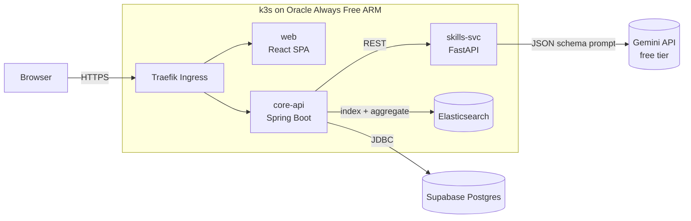

<div align="center">

# 🧺 SkillSieve

**Sift job posts. Find your gaps. Land the offer.**

<!-- Replace OWNER after the repo is created -->


</div>

> Version 0.1 · Last updated 2026-11-22 22:41 SGT

SkillSieve is a job-search tracker for software engineers. Paste a job post, and SkillSieve:

- 📋 **tracks** the application on a status board (Saved → Applied → Interview → Offer)
- 🤖 **extracts** required and preferred skills with an LLM
- 📊 **shows your skill gaps** across every post you saved, so you know what to learn next

I built it to run my own job search — and to practise the platform skills those job posts ask for.

<!-- Add a GIF or screenshot here: docs/assets/demo.gif -->

---

## ✨ Features

| Release 1 (MVP) | Release 2 |
|---|---|
| Paste a job post → saved + skills extracted | Save from LinkedIn / MyCareersFuture with a Chrome extension |
| Kanban status board with drag-and-drop | Async extraction through RabbitMQ |
| Skill-gap dashboard (Elasticsearch aggregations) | Prometheus + Grafana + Loki dashboards and alerts |
| Your skills profile (level 0–3) | AI resume tailoring per job (local model, private) |
| Full-text search across saved posts | Keycloak single sign-on, invite friends |

## 🏗️ Architecture



More detail: [docs/ARCHITECTURE.md](docs/ARCHITECTURE.md)

## 🧰 Tech stack

**Front end:** React 18 · TypeScript · Vite · TanStack Query · Tailwind CSS
**Back end:** Java 21 · Spring Boot 3 · Python 3.12 · FastAPI · Pydantic
**Data:** PostgreSQL (Supabase) · Elasticsearch 8
**AI:** Gemini Flash-Lite (structured JSON output) · content-hash caching
**Platform:** Docker · k3s (Kubernetes) · Helm · Traefik · cert-manager · Sealed Secrets
**CI/CD & security:** GitHub Actions · GHCR · Trivy · Gitleaks · Dependabot

All of it runs on free tiers — **$0 per month**.

## 🚀 Quick start (local)

**Needs:** Docker, Node 20+, Java 21, Python 3.12, [uv](https://docs.astral.sh/uv/), a free [Gemini API key](https://aistudio.google.com/).

```bash
git clone https://github.com/OWNER/skillsieve.git
cd skillsieve
cp .env.example .env            # add GEMINI_API_KEY
docker compose -f deploy/local/docker-compose.yml up -d
```

Open http://localhost:5173.

Run each service on its own (for development): see [CLAUDE.md §5](CLAUDE.md#5-commands).

## ☁️ Deploy

1. Create an Oracle Cloud **Always Free** ARM VM (2 OCPU / 12 GB).
2. Run `deploy/k3s/bootstrap.sh` on the VM (installs k3s, cert-manager, sealed-secrets).
3. Add repo secrets: `KUBE_SSH_HOST`, `KUBE_SSH_KEY`, sealed app secrets.
4. Push to `main` → GitHub Actions tests, scans, builds arm64 images, and runs `helm upgrade`.

Full guide: [docs/TECHNICAL_DESIGN.md §9](docs/TECHNICAL_DESIGN.md)

## 📚 Docs

| Doc | What's inside |
|---|---|
| [PRD](docs/PRD.md) | Problem, users, scope, user stories, success metrics |
| [Architecture](docs/ARCHITECTURE.md) | System diagrams, deployment, RAM budget, decisions (ADRs) |
| [Design](docs/DESIGN.md) | Screens, design tokens, components, accessibility |
| [Technical Design](docs/TECHNICAL_DESIGN.md) | Data model, API contract, LLM contract, CI/CD, ops |
| [Coding Standards](docs/CODING_STANDARDS.md) | Style, Git workflow, testing, security rules |

## 🗺️ Roadmap

- [ ] R1 — Platform base (k3s, HTTPS, CI/CD)
- [ ] R1 — Status board + core API
- [ ] R1 — Skill extraction + gap dashboard
- [ ] R2 — Chrome extension
- [ ] R2 — RabbitMQ async pipeline
- [ ] R2 — Observability stack
- [ ] R2 — Private resume tailoring

## 📄 License

MIT © 2026
