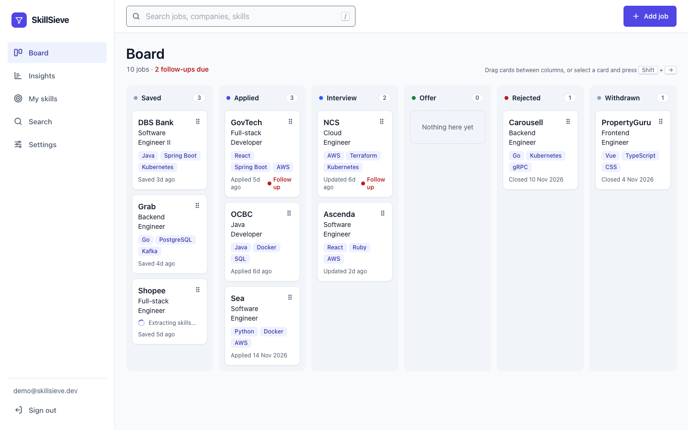
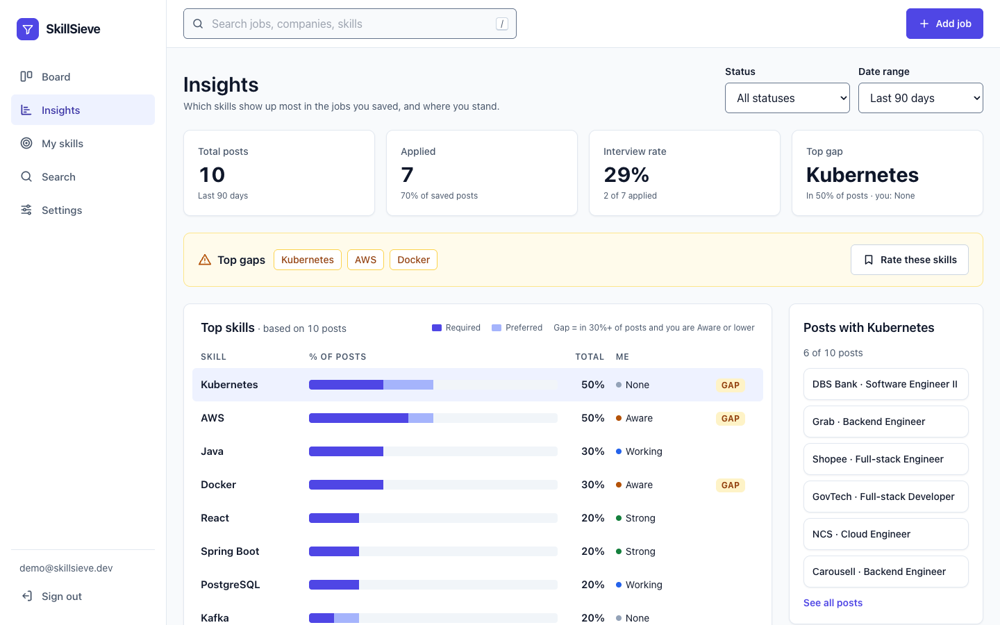
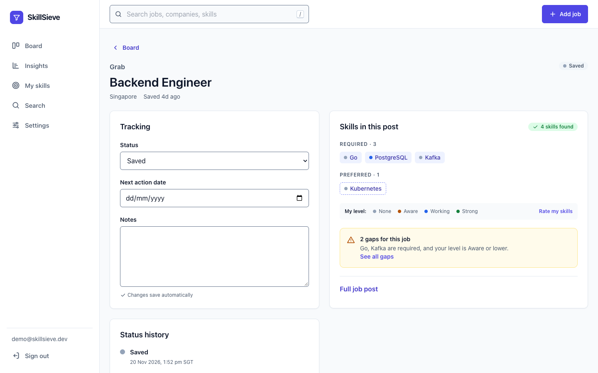
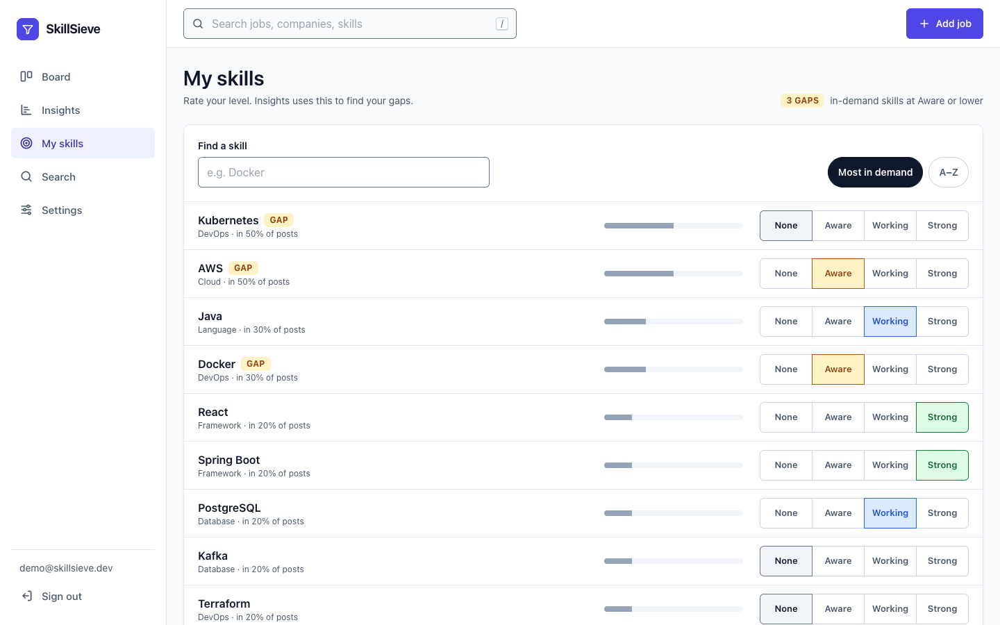
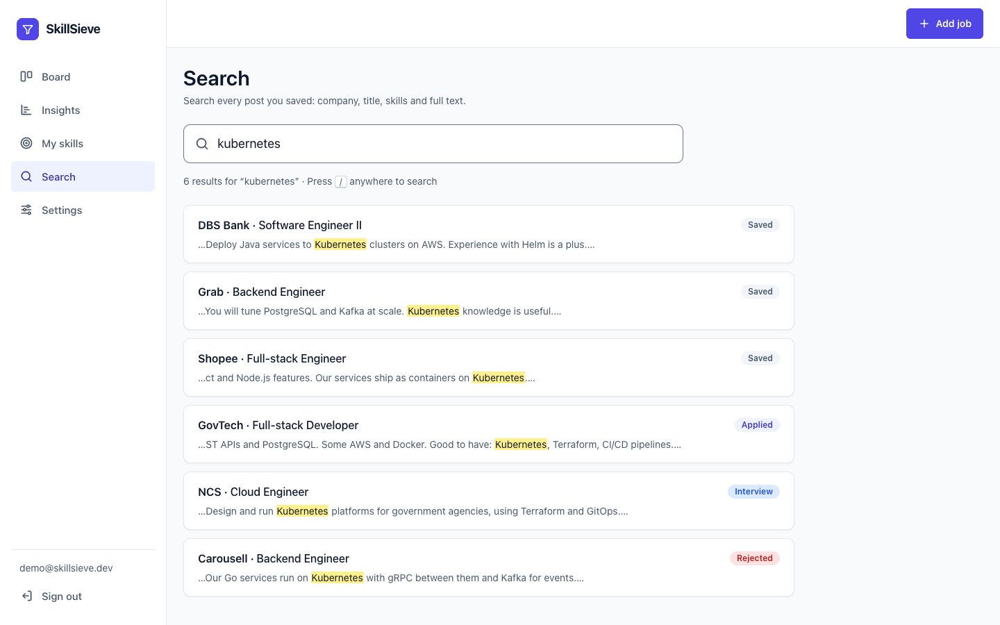
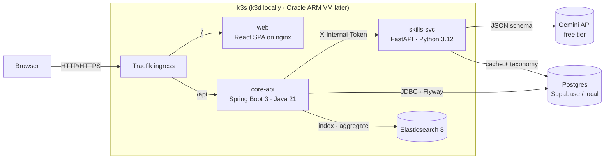

<div align="center">

# 🧺 SkillSieve

**Sift job posts. Find your gaps. Land the offer.**


</div>

> Version 0.2 · Last updated 2026-11-24 SGT

SkillSieve is a job-search tracker for software engineers. Paste a job post, and SkillSieve:

- 📋 **tracks** the application on a status board (Saved → Applied → Interview → Offer)
- 🤖 **extracts** company, title and required/preferred skills with Gemini (cached, privacy-filtered)
- 📊 **shows your skill gaps** across every post you saved, so you know what to learn next

I built it to run my own job search, and to practise the platform skills those job posts ask for.



| Skill gaps | Job detail |
|---|---|
|  |  |
| **My skills** | **Search** |
|  |  |

<sub>Screenshots use the built-in demo data (`VITE_USE_MOCKS=true`). Companies and posts are fictional.</sub>

---

## ✨ What works today

| Area | Status |
|---|---|
| Sign in (owner account, JWT in an HttpOnly cookie), read-only demo role | ✅ |
| Paste a post → saved, duplicate check by normalised SHA-256, status board with drag and keyboard moves | ✅ |
| Skill extraction: Gemini Flash-Lite with JSON schema, cache by text hash, PII redaction, quota guard | ✅ |
| Skill-gap dashboard and full-text search on Elasticsearch, with Postgres fallback | ✅ |
| Your skill levels (0–3), status history, follow-up dates, notes | ✅ |
| Extraction eval: 20 labelled posts, **precision 1.00 · recall 0.89** on real Gemini output | ✅ |
| Runs on a k3s cluster with one command (k3d on macOS / WSL2), reachable on the LAN | ✅ |
| Public deploy on Oracle Always Free (bootstrap + pipeline written, VM capacity pending) | ⏳ |
| Release 2: Chrome extension, RabbitMQ, Prometheus/Grafana/Loki, Keycloak, resume tailoring | 🗺️ |

## 🏗️ Architecture



- **Big picture, deployment, RAM budget, ADRs:** [docs/ARCHITECTURE.md](docs/ARCHITECTURE.md)
- **Diagrams:** ER, class diagrams for each service, state, sequence and flowcharts for every main workflow, in [docs/DIAGRAMS.md](docs/DIAGRAMS.md)

## 🧰 Tech stack

**Front end:** React 18 · TypeScript (strict) · Vite · TanStack Query · React Hook Form + Zod · Tailwind CSS · MSW
**core-api:** Java 21 · Spring Boot 3.5 · Spring Security (JWT) · Spring Data JPA · Flyway · Elasticsearch Java client
**skills-svc:** Python 3.12 · FastAPI · Pydantic v2 · google-genai · asyncpg · RapidFuzz · structlog
**Data:** PostgreSQL 16 (RLS on) · Elasticsearch 8.18
**Platform:** Docker (multi-arch, non-root, read-only root FS) · k3s · Helm · Traefik · cert-manager · Sealed Secrets
**Quality and security:** Vitest · JUnit 5 + Testcontainers · pytest · Error Prone · SpotBugs · mypy --strict · ruff · Trivy · Gitleaks · Dependabot · GitHub Actions

All of it runs on free tiers: **$0 per month**.

## 🚀 Quick start: the whole stack on a local k3s cluster

**Needs:** Docker Desktop, plus `brew install k3d helm kubectl` (on WSL2, use your package manager).

```bash
git clone https://github.com/sayoungestguy/skillsieve.git && cd skillsieve
```

```bash
deploy/local/k3d-up.sh
```

This starts Postgres and creates a k3s cluster. It also builds and deploys web, core-api, skills-svc and Elasticsearch with Helm, then runs a smoke test. When it's done, open **http://localhost:8089**. Your owner login is in `deploy/local/.owner-credentials` (git-ignored).

To switch on skill extraction, get a free key at [AI Studio](https://aistudio.google.com/apikey) and run this once. It reads the key without echoing it:

```bash
read -rs GEMINI_API_KEY && export GEMINI_API_KEY && deploy/local/k3d-up.sh
```

To check the release from inside the cluster:

```bash
helm test skillsieve -n skillsieve
```

Details, LAN access and WSL2 notes: [deploy/local/README.md](deploy/local/README.md)

### Develop one service at a time

| Service | Run | Check |
|---|---|---|
| web | `cd apps/web && npm ci && npm run dev` (demo data, no backend needed) | `npm run lint && npm run typecheck && npm test` |
| core-api | `docker compose -f deploy/local/docker-compose.yml up -d postgres`, then `./mvnw spring-boot:run -Dspring-boot.run.profiles=local` | `./mvnw verify` |
| skills-svc | `cp .env.example .env && uv sync && uv run uvicorn app.main:app --reload` | `uv run ruff check . && uv run mypy app tests eval && uv run pytest` |

## 🧪 Quality gates

| | web | core-api | skills-svc |
|---|---|---|---|
| Tests | 30 (Vitest + RTL + MSW) | 43 (19 unit + 24 Testcontainers: Postgres + ES) | 39 (fixtures + Testcontainers Postgres + eval) |
| Coverage gate | 70% (89% now) | 80% JaCoCo (91% now) | 80% (91% now) |
| Static checks | ESLint strict, Prettier, `tsc --strict` | Spotless, Error Prone, SpotBugs | ruff, mypy --strict |
| Images (Trivy) | 0 fixable HIGH/CRITICAL | 0 fixable (2 Spring-7-only CVEs documented in `.trivyignore`) | 0 |
| Helm | `helm lint`, kubeconform (3 value sets), Trivy config: 0 HIGH/CRITICAL, `helm test` smoke pod | | |

Security notes: no secrets in Git (Gitleaks, Sealed Secrets), cross-user access returns 404 (tested), CSP and security headers on nginx, BCrypt cost 12, rate-limited login, internal token between services. Contact details are removed before any text goes to the free LLM tier.

## ☁️ Deploy to Oracle Always Free (when capacity allows)

The pipeline is ready but set to manual while the VM is on hold:

1. Create an **Always Free** ARM VM (2 OCPU / 12 GB): [deploy/k3s/README.md](deploy/k3s/README.md)
2. Run `deploy/k3s/bootstrap.sh` on it (k3s, firewall, cert-manager, Sealed Secrets, restricted deploy user, DuckDNS).
3. Set up Supabase: [docs/runbooks/supabase.md](docs/runbooks/supabase.md)
4. Add the repo secrets and variables, then run the `deploy` workflow. It builds arm64 + amd64 images, runs a Trivy scan, then `helm upgrade --atomic` and a smoke test.

## 📚 Docs

| Doc | What's inside |
|---|---|
| [PRD](docs/PRD.md) | Problem, users, scope, user stories, release plan |
| [Architecture](docs/ARCHITECTURE.md) | C4 views, deployment, RAM budget, ADRs |
| [Diagrams](docs/DIAGRAMS.md) | ER diagram, class diagrams, state, sequence and flowcharts |
| [Design](docs/DESIGN.md) | Screens, design tokens, components, accessibility |
| [Technical Design](docs/TECHNICAL_DESIGN.md) | Data model, API and LLM contracts, config, CI/CD, ops |
| [Coding Standards](docs/CODING_STANDARDS.md) | Style, Git workflow, testing, security rules |
| [Extraction eval](services/skills-svc/eval/README.md) | Labelled posts, scores, caveats |
| [Demo script](docs/DEMO.md) | 3-minute walkthrough for the demo video |

## 🗺️ Roadmap

- [x] R1: Platform base (k3s, Helm, CI/CD, security scanning). Running locally; public VM pending.
- [x] R1: Status board, core API, sign-in
- [x] R1: Skill extraction, Elasticsearch gap dashboard and search, eval set
- [x] R1: Demo video (recorded with Playwright, `npm run demo`)
- [ ] R1: Public deploy (Oracle VM + Supabase)
- [ ] R2: Chrome extension · RabbitMQ async pipeline · observability stack · Keycloak · private resume tailoring
