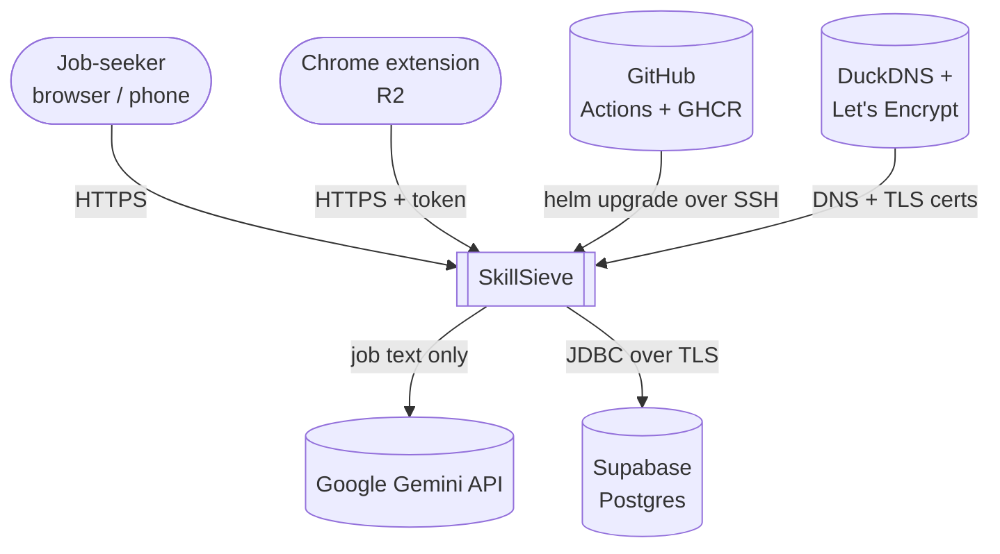
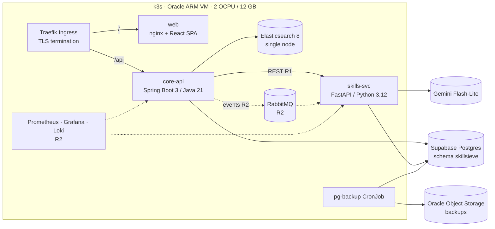
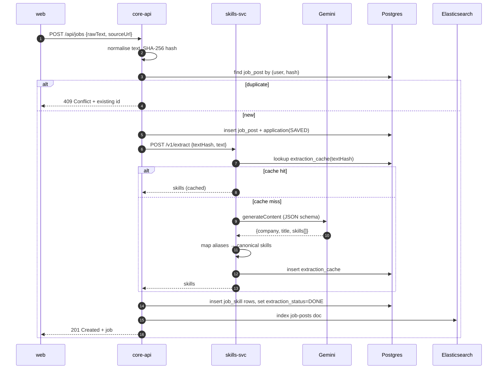
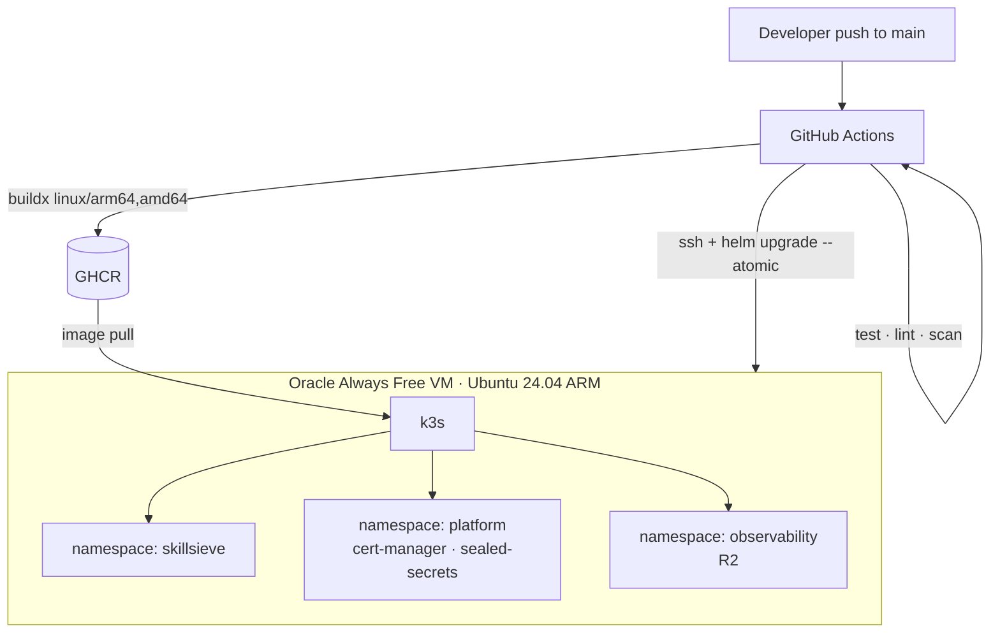

# Architecture — SkillSieve

> Version 0.1 · Last updated 2026-11-22 22:41 SGT · Status: Draft

> Detailed ER, class, state, sequence and flow diagrams: [DIAGRAMS.md](DIAGRAMS.md).

## 1. Overview

SkillSieve is a small set of services on a single-node **k3s** cluster (Oracle Always Free ARM VM).
State lives in **Supabase Postgres** (managed, free) and **Elasticsearch** (in-cluster).
An LLM (**Gemini Flash-Lite**, free tier) extracts skills from job posts.

Design drivers, in order:
1. **$0 cost** and **12 GB RAM** limit.
2. **Show real-world skills** (microservices, Kubernetes, CI/CD, search, LLM integration).
3. **Simple enough to ship R1 in 10 days.**

## 2. System context (C4 level 1)

## 3. Containers (C4 level 2)

| Container | Responsibility | Owns |
|---|---|---|
| **web** | SPA: board, job detail, gap dashboard, skills profile | No data |
| **core-api** | System of record. Auth, jobs, applications, status history, user skills, search & insights. Writes ES index. | Tables: `job_post`, `application`, `status_event`, `user_skill`, `app_user` |
| **skills-svc** | Skill extraction: normalise text, check cache, call LLM, map to taxonomy | Tables: `skill`, `skill_alias`, `extraction_cache` |
| **Elasticsearch** | Full-text search + aggregations for the gap dashboard | Index `job-posts` (derived, can be rebuilt from Postgres) |
| **pg-backup** | Nightly `pg_dump` → Oracle Object Storage, 7-day retention | Backup files |

**Rule:** Postgres is the source of truth. Elasticsearch is a read model and can be rebuilt with `POST /api/admin/reindex`.

## 4. Key flows

### 4.1 Save a job post (R1, synchronous)

Failure: if skills-svc times out (10 s) or Gemini quota is hit, core-api stores the job with `extraction_status=PENDING` and returns 201. The UI shows "Skills pending — retry". A retry button calls `POST /api/jobs/{id}/extract`.

### 4.2 Save a job post (R2, asynchronous)

core-api publishes `job.created` to RabbitMQ → skills-svc consumes, extracts, publishes `job.skills.extracted` → core-api consumes, writes `job_skill`, indexes ES. The UI polls or uses Server-Sent Events.

### 4.3 Gap dashboard

`GET /api/insights/skills?status=APPLIED&from=…` → core-api runs an ES `terms` aggregation on `skills.required` and `skills.preferred`, filtered by user + status + date → joins with `user_skill` levels from Postgres → returns rows with `frequencyPct`, `myLevel`, `isGap`.

## 5. Deployment view

> **Current (interim):** self-hosted on a k3d cluster: the MacBook now, a Windows PC with WSL2 later. The app is reachable on the home LAN only, deployed by `deploy/local/k3d-up.sh` with `values-local.yaml`. The Oracle VM target below is on hold (no free A1 capacity in `ap-singapore-1`), so `deploy.yml` is manual-only. See `deploy/local/README.md`.

- **Ingress:** Traefik (bundled with k3s). Host `skillsieve.duckdns.org` (or `skillsieve.dev`).
- **TLS:** cert-manager ClusterIssuer `letsencrypt-prod`, HTTP-01 challenge.
- **Secrets:** Sealed Secrets controller; encrypted `SealedSecret` YAML committed to Git.
- **Storage:** k3s `local-path` provisioner for the Elasticsearch PVC (10 Gi).
- **Firewall:** Oracle security list and UFW open 22, 80, 443. SSH is open to all because GitHub-hosted runners have no fixed IPs, so it is key-only, rate-limited (`ufw limit`) and guarded by fail2ban. The deploy key is forced to a `helm`/`kubectl`-only shell with a namespace-scoped ServiceAccount. The k3s API (6443) is not public.
- **Chart delivery:** CI pushes the Helm chart to GHCR as an OCI artifact; the VM runs `helm upgrade` from `oci://ghcr.io/<owner>/charts/skillsieve`. Images and chart are public GHCR packages, so no pull secret is needed.

## 6. RAM budget (12 GB node)

| Component | Request | Limit |
|---|---|---|
| k3s system (Traefik, CoreDNS, metrics-server, local-path) | ~0.8 GB | — |
| cert-manager + sealed-secrets | 0.15 GB | 0.3 GB |
| web (nginx) | 32 MB | 64 MB |
| core-api (JVM, `-XX:MaxRAMPercentage=75`) | 384 MB | 768 MB |
| skills-svc | 128 MB | 256 MB |
| Elasticsearch (heap 1 GB) | 1.5 GB | 2 GB |
| pg-backup CronJob (runs briefly) | 64 MB | 128 MB |
| **R1 subtotal (limits)** | | **≈ 4.3 GB** |
| RabbitMQ (R2) | 256 MB | 512 MB |
| Prometheus + Grafana + Loki (R2) | 0.8 GB | 1.5 GB |
| Keycloak (R2) | 512 MB | 1 GB |
| **R2 total (limits)** | | **≈ 7.3 GB** |
| Headroom for other portfolio apps | | ≈ 4.7 GB |

Postgres is on Supabase, so it uses no cluster RAM.

## 7. Cross-cutting concerns

| Concern | Approach |
|---|---|
| Auth | R1: core-api issues a JWT (HS256, 1 h) after password login; HttpOnly, Secure, SameSite=Strict cookie. R2: Keycloak OIDC. |
| Service-to-service | ClusterIP only; skills-svc not exposed by ingress. Shared token header `X-Internal-Token` (R1), NetworkPolicy (R2). |
| Config | 12-factor env vars from ConfigMap + Secret. |
| Logging | JSON logs to stdout. No PII. `traceId` in every log line. |
| Observability | `/actuator/health`, `/healthz` probes in R1. OpenTelemetry + Prometheus metrics in R2. |
| Rate limiting | skills-svc: token bucket under Gemini free limits; core-api: 60 req/min per user. |
| Backups | Nightly `pg_dump` CronJob → Oracle Object Storage, 7 copies. |

## 8. Architecture Decision Records (ADRs)

| # | Decision | Why | Trade-off |
|---|---|---|---|
| ADR-001 | **k3s on Oracle Always Free** instead of EKS/GKE | $0, real Kubernetes API, Helm works the same | Single node, no HA; ARM-only images |
| ADR-002 | **Supabase Postgres** instead of in-cluster Postgres | Saves ~0.5 GB RAM, managed TLS, Singapore region | 500 MB cap, no auto-backups (we add our own), may pause if idle |
| ADR-003 | **Two services** (Java + Python), not one | Shows microservices; Python is best for LLM/NLP libs; Java is my strength | More moving parts; network calls between services |
| ADR-004 | **Elasticsearch** for search + analytics | Asked for in job posts; aggregations are perfect for skill frequency | ~1.5 GB RAM; must keep in sync with Postgres |
| ADR-005 | **Gemini Flash-Lite + JSON schema** | Free tier, no card; structured output avoids parsing bugs | Low daily quota; free-tier data may be used for training → no PII |
| ADR-006 | **Sync extraction in R1, async (RabbitMQ) in R2** | Ship fast first; then show event-driven design as an upgrade | R1 request can take up to 10 s |
| ADR-007 | **Monorepo** | One PR can change API + UI + Helm; simpler CI | CI needs path filters to stay fast |
| ADR-008 | **Sealed Secrets** instead of Vault | Tiny footprint, GitOps-friendly | Less powerful than Vault (no dynamic secrets) |
