# Diagrams — SkillSieve

> Version 0.2 · Last updated 2026-11-24 SGT
> Every diagram is drawn from the code as it is today (Mermaid, so GitHub renders them). If you change a table, class or flow, update its diagram in the same PR (CLAUDE.md rule 2).
> Big-picture C4 views live in [ARCHITECTURE.md](ARCHITECTURE.md). This file goes one level deeper.

| # | Diagram | Type |
|---|---|---|
| 1 | [Data model](#1-data-model-er-diagram) | ER diagram |
| 2 | [core-api domain model](#2-core-api-domain-model) | Class diagram |
| 3 | [core-api services and adapters](#3-core-api-services-and-adapters) | Class diagram |
| 4 | [skills-svc](#4-skills-svc) | Class diagram |
| 5 | [web front end](#5-web-front-end) | Module diagram |
| 6 | [Application status](#6-application-status-lifecycle) | State diagram |
| 7 | [Save a job post, end to end](#7-save-a-job-post-end-to-end) | Sequence diagram |
| 8 | [Skill extraction inside skills-svc](#8-skill-extraction-inside-skills-svc) | Flowchart |
| 9 | [Sign-in and session](#9-sign-in-and-session) | Sequence diagram |
| 10 | [Move a card (optimistic locking)](#10-move-a-card-optimistic-locking) | Flowchart |
| 11 | [Search index sync and reindex](#11-search-index-sync-and-reindex) | Flowchart |
| 12 | [Search and insights with fallback](#12-search-and-insights-with-fallback) | Flowchart |
| 13 | [CI/CD pipeline](#13-cicd-pipeline) | Flowchart |
| 14 | [Local cluster deploy (`k3d-up.sh`)](#14-local-cluster-deploy-k3d-upsh) | Flowchart |

---

## 1. Data model (ER diagram)

Postgres schema `skillsieve`, created by `V1__init.sql` and owned by core-api's Flyway. Row Level Security is on for every table with no policies (TECHNICAL_DESIGN §3).

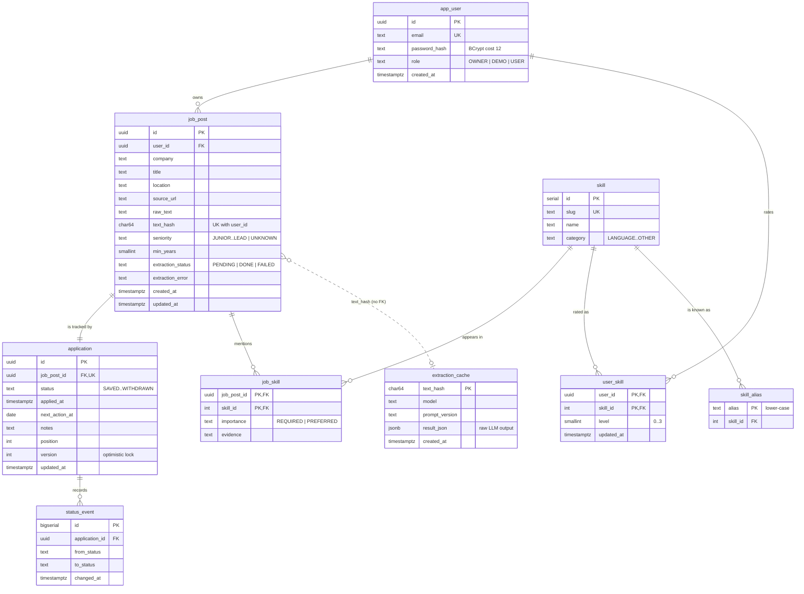

| Rule | Where |
|---|---|
| Deleting a user removes their posts, applications, events, job skills and levels | `ON DELETE CASCADE` |
| A skill that is still referenced can't be deleted | `job_skill` / `user_skill` → `ON DELETE RESTRICT` |
| The same text can't be saved twice by one user | `UNIQUE (user_id, text_hash)` → API 409 + `existingId` |
| `skill` and `skill_alias` are seeded, never edited by hand | `R__seed_skills.sql` generated from `data/taxonomy/skills.yaml` |
| `extraction_cache` is shared by everyone (it holds public post text only) | Read and written by skills-svc only |

---

## 2. core-api domain model

JPA entities (package by feature). Controllers never return entities. DTOs are `record`s (diagram 3).

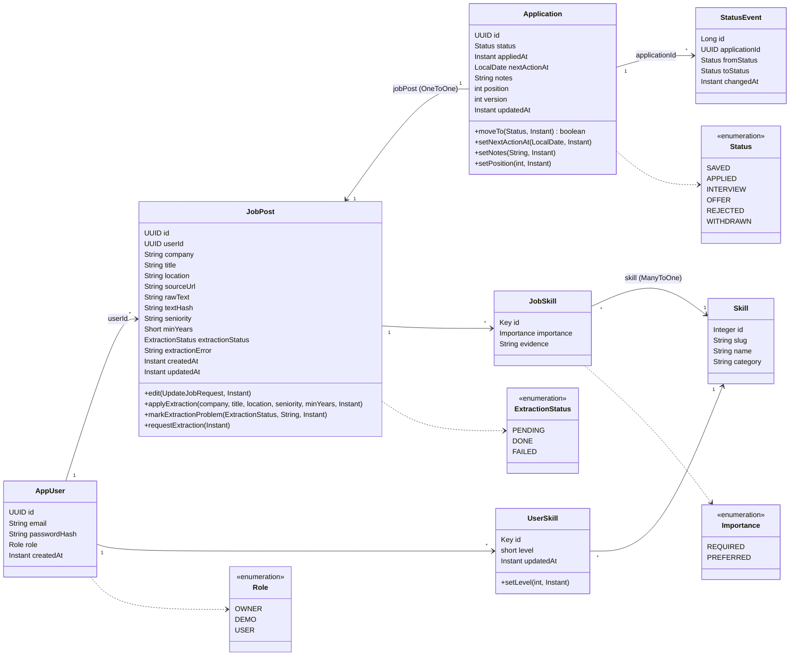

---

## 3. core-api services and adapters

Controller → Service → Repository per feature. Cross-feature work goes through events (`JobChangedEvent`) or narrow adapters (`SkillsClient`, `JobIndex`).

```mermaid
classDiagram
  direction TB
  class AuthController {
    +login(LoginRequest) 204 + Set-Cookie
    +logout() 204
    +me() MeDto
  }
  class JobController {
    +create(CreateJobRequest) 201 JobDto
    +board(status, q, page, size) PageDto~JobSummaryDto~
    +get(id) JobDto
    +update(id, UpdateJobRequest) JobDto
    +delete(id) 204
    +extract(id) 202
  }
  class ApplicationController {
    +update(id, ApplicationPatch) ApplicationDto
    +history(id) List~StatusEventDto~
  }
  class SkillController {
    +list(q, category) List~SkillDto~
    +setLevel(slug, SetLevelRequest) UserSkillDto
  }
  class InsightController {
    +summary() InsightSummaryDto
    +skills(status, from, to, limit) List~SkillInsightDto~
  }
  class SearchController {
    +search(q, page, size) PageDto~SearchHitDto~
  }
  class AdminController {
    +reindex() 202 indexed
  }

  class AuthService
  class LoginRateLimiter {
    +check(clientIp)
  }
  class JobService {
    +create(userId, req) JobDto
    +board(...) PageDto
    +get(userId, jobId) JobDto
    +update(userId, jobId, req) JobDto
    +delete(userId, jobId)
    +requestExtraction(userId, jobId)
  }
  class ApplicationService {
    +update(userId, appId, patch) ApplicationDto
    +history(userId, appId) List
  }
  class ExtractionService {
    +extract(jobId)
  }
  class SkillsClient {
    +extract(textHash, text) Optional~ExtractionResultDto~
  }
  class SkillService
  class InsightService {
    +summary(userId)
    +skills(userId, status, from, to, limit)
  }
  class EsSkillInsights {
    <<static>>
    +query(client, jdbc, ...) List
  }
  class SearchService {
    +search(userId, q, page, size)
  }
  class PostgresSearch {
    +search(...) fallback
  }
  class JobIndex {
    +ensureIndex() @Scheduled 15s
    +sync(jobId, deleted)
    +reindex() int
    +ready() boolean
  }
  class JobIndexListener {
    +on(JobChangedEvent) AFTER_COMMIT
  }
  class JobDocuments {
    +find(jobId) Optional~JobDocument~
    +forEach(sink)
  }
  class JobChangedEvent {
    <<record>>
    UUID jobId
    boolean deleted
  }
  class TextNormaliser {
    <<utility>>
    +normalise(text)
    +hashOf(rawText) sha256
  }
  class ApiExceptionHandler {
    RFC 7807 ProblemDetail
  }

  AuthController --> AuthService
  AuthController --> LoginRateLimiter
  JobController --> JobService
  JobController --> ExtractionService
  ApplicationController --> ApplicationService
  SkillController --> SkillService
  InsightController --> InsightService
  SearchController --> SearchService
  AdminController --> JobIndex

  JobService ..> TextNormaliser
  JobService ..> JobChangedEvent : publishes
  ApplicationService ..> JobChangedEvent : publishes
  ExtractionService ..> JobChangedEvent : publishes
  ExtractionService --> SkillsClient : HTTP, outside DB tx
  JobIndexListener ..> JobChangedEvent : handles
  JobIndexListener --> JobIndex
  JobIndex --> JobDocuments
  SearchService --> JobIndex : ready?
  SearchService --> PostgresSearch : fallback
  InsightService --> EsSkillInsights
  InsightService --> JobIndex : ready?
```

Security filter chain (in order): `ApiRequestGuardFilter` (64 KB cap, `X-Requested-With` on writes) → JWT from the `ss_token` cookie (Nimbus HS256) → role rules (`/api/admin/**` OWNER, `GET` any signed-in user, other writes OWNER/USER, so DEMO is read-only).

---

## 4. skills-svc

FastAPI. `api/` → `extraction/` → adapters (`llm/`, `cache/`, `taxonomy/`). The LLM sits behind a Protocol, so tests and the eval replay recorded output.

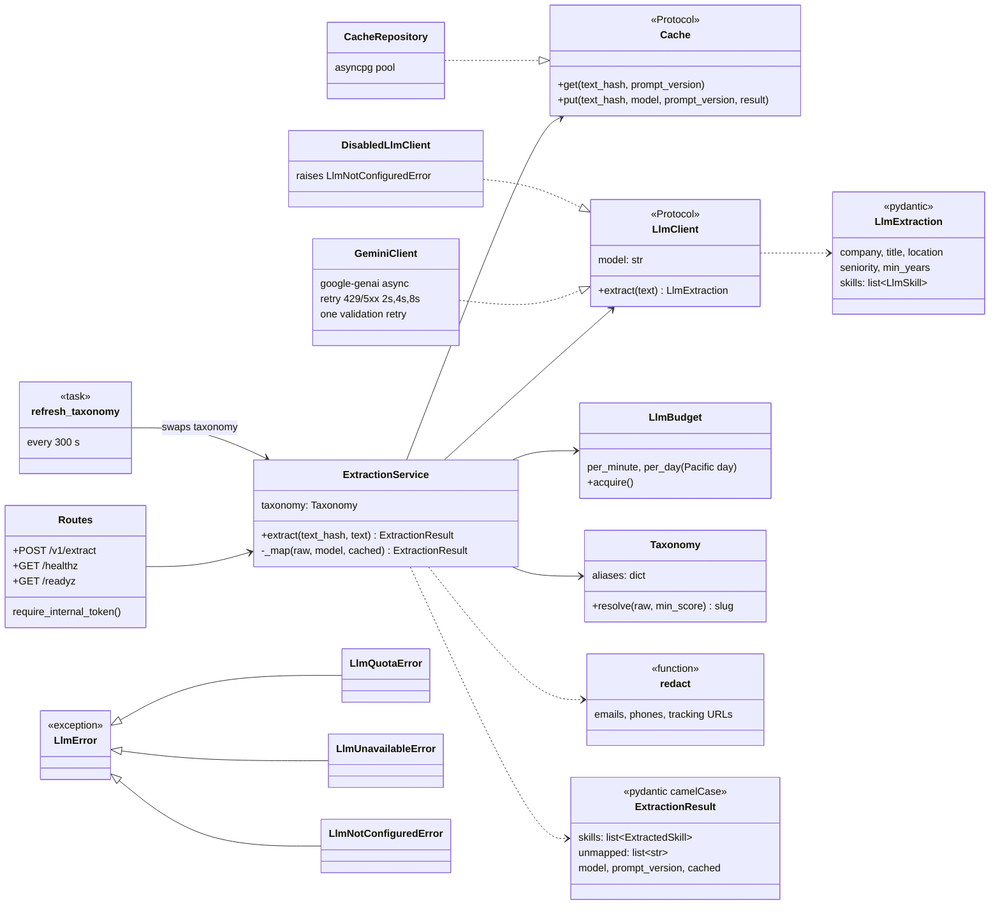

| Exception | HTTP | core-api then sets the job to |
|---|---|---|
| `LlmQuotaError` (own budget or Gemini 429) | 429 | `PENDING` + "try again later" |
| `LlmUnavailableError`, `LlmNotConfiguredError` | 503 | `PENDING` + "try again later" |
| bad token / bad body | 401 / 422 | `FAILED` |

---

## 5. web front end

React 18 + TanStack Query. Components never call `fetch`; all HTTP goes through `src/api/`.

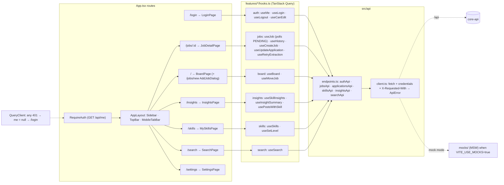

---

## 6. Application status lifecycle

The API allows any status change (users fix mistakes). These are the normal paths. Every change writes a `status_event`, and the first move to `APPLIED` sets `applied_at`.

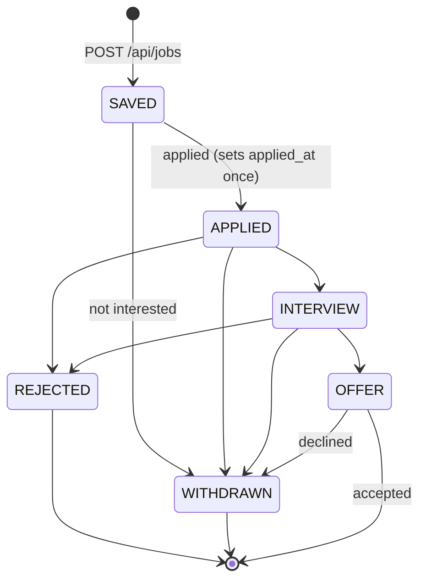

---

## 7. Save a job post, end to end

R1 is synchronous (ADR-006). Saving never fails because of extraction.

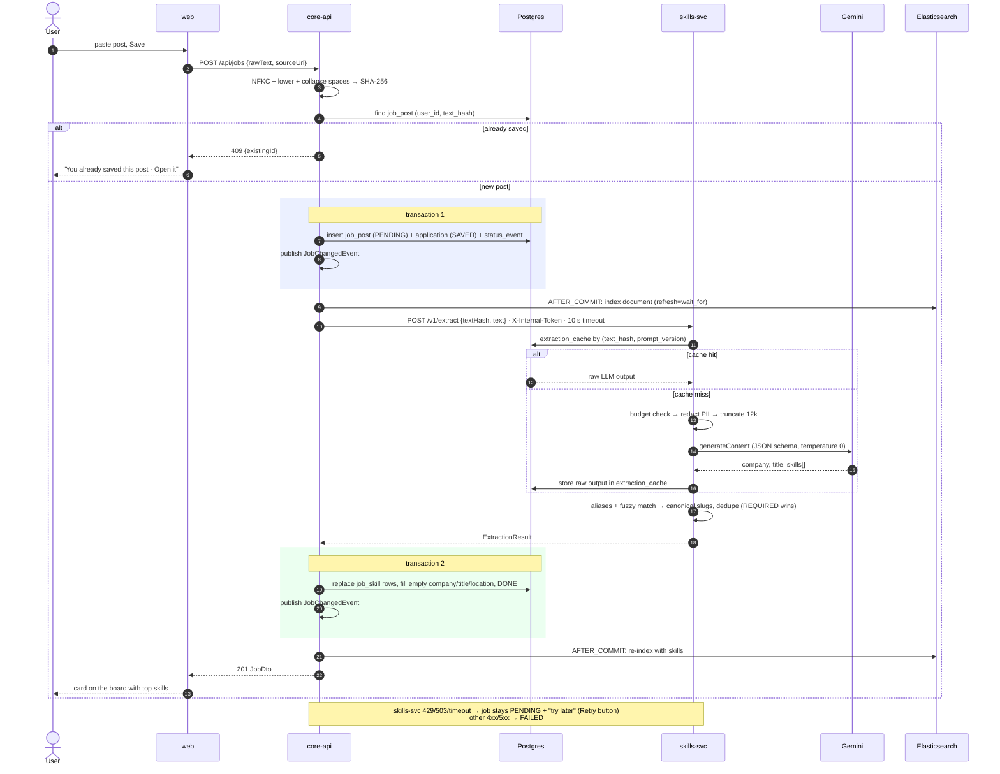

---

## 8. Skill extraction inside skills-svc

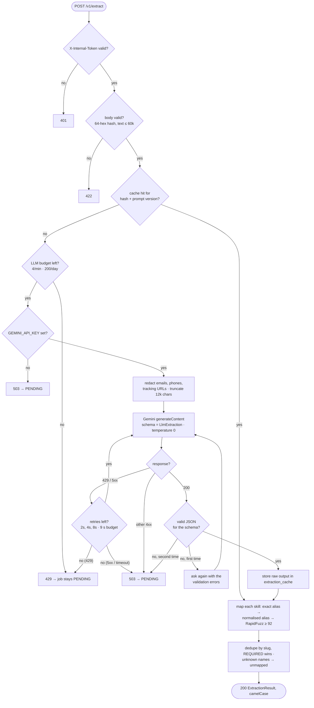

---

## 9. Sign-in and session

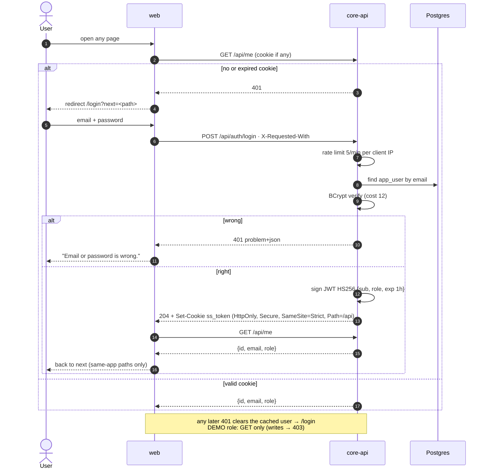

---

## 10. Move a card (optimistic locking)

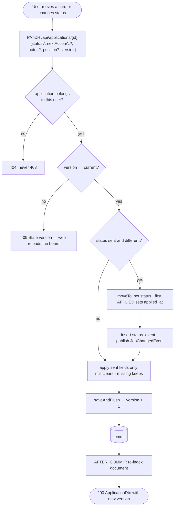

---

## 11. Search index sync and reindex

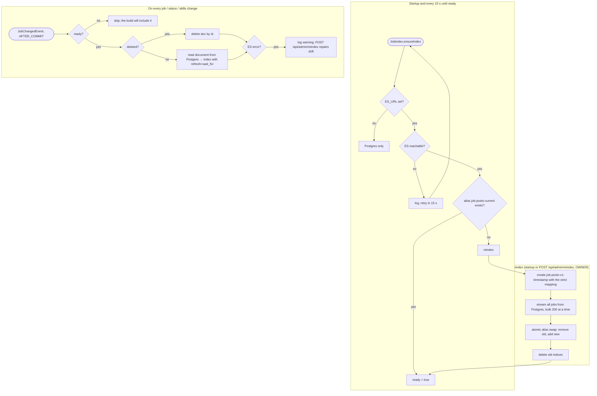

---

## 12. Search and insights with fallback

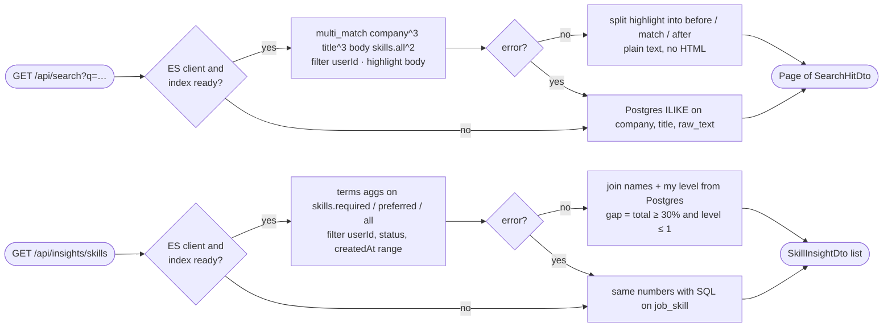

---

## 13. CI/CD pipeline

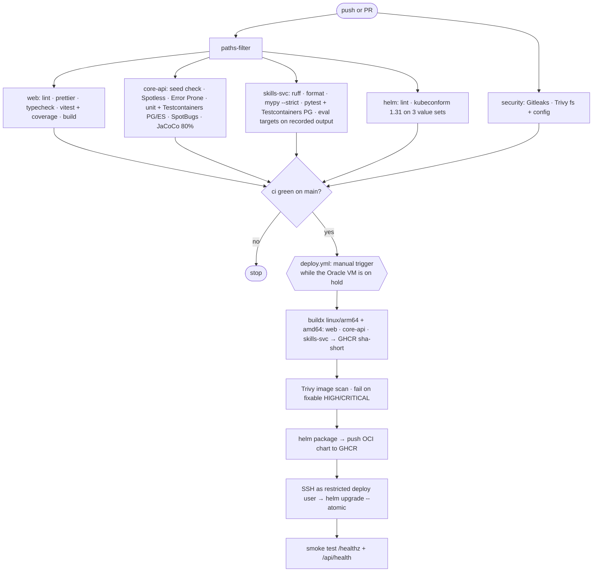

---

## 14. Local cluster deploy (`k3d-up.sh`)

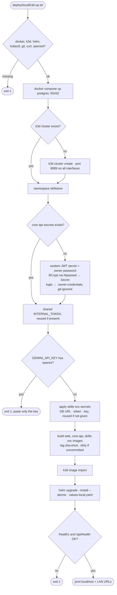
